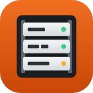

<p align="center"></p>

# Rackline

Rackline is a rack planner that runs in your browser. Use it to lay out a home lab, studio, gaming setup, security cabinet, small office or touring A/V rig: place devices, wire them up, and check that everything fits before you build it.

It's a React app built with Vite. There's no server or account: everything runs in the browser.

## Features

**Building racks**
- A library of 65 devices: audio, video, lighting, network, power, utility, and a Home & DIY section (PCs, servers, NAS, Wi-Fi router, modem, PS5, PS4, NVRs, Raspberry Pis, keystone panels, UPS and more).
- **Make your own device:** set the height, depth, weight, power and look, then add your own ports on the front and back, with a live preview.
- **Custom patch panels** with up to 48 labelled ports (XLR, etherCON, RJ45, BNC, LC fiber, powerCON).
- Devices can be mounted on the front rails or the back rails.
- **Arrange mode** snaps devices into free slots. **Free move** lets you place a device at any U, even between units: snap to ½U, ⅓U (one rail hole) or turn snapping off.
- Several racks per project, plus a **Site** view that shows them all with the links between them.

**Cables**
- Typed cables: Network (Cat6), HDMI, Power (IEC), Power adapter (DC), USB, Fiber, Coax/SDI, Audio and Speaker. Each type has its own look, and the type is detected from the ports you connect.
- Drag from port to port to connect them, drag a plug to move it, and drag the middle of a cable to bend it.
- Warns you when the two ends don't match (for example RJ45 to HDMI means you need an adapter) and when a device isn't plugged into power.
- **Auto manage** routes every cable neatly through the side channels. **Colour by type** gives each cable type its own colour.
- Shows the length of each cable run and suggests the cable size to buy.

**Views**
- **Front, Rear, Both** (front and back side by side), **Side** (shows how deep everything sits), **Site** and **Report**.
- **3D view** (three.js): orbit around the road case, see every faceplate and back panel, watch cables run as 3D tubes, drag devices, and wire by tapping one port then another.
  - Lights on / Dim room modes, LED strips (seven colours or rainbow), and a working Rack Light device.
  - Spinning fans and an optional **Fan sound** that reacts to how many fans are in view.

**Planning**
- Totals for space used, weight, power draw and current, in metric (230 V) or US units (120 V).
- Labels, label colours and groups, and you can highlight a group to find its devices.
- The **Report** lists every device, patch port and cable, and copies to plain text.
- Undo and redo, starter templates, and backup or restore of your project as JSON.
- Designed in Apple's style: system font and colours, frosted-glass bars, iOS segmented controls, grouped lists, sheets and line icons, in light and dark mode.
- Works on phones: a View menu, a bottom toolbar, slide-up sheets, a floating selection bar, and touch-and-hold to drag. The 3D view has floating glass controls and a Lighting popover.

## Starter templates

Home lab · Gaming & media · Home security · Network closet · Small office · Home studio · Touring A/V (two racks) · Blank rack

## Run it locally

You need Node.js 18 or newer.

```bash
npm install
npm run dev
```

Then open the address it prints (usually http://localhost:5173).

To make a production build and try it:

```bash
npm run build
npm run preview
```

Google Fonts load from the web. three.js is bundled, and loads only when you open the 3D view.

## Deploy to Vercel

The repo is set up for Vercel (`vercel.json`: framework Vite, output `dist`).

- **From the dashboard:** Add New → Project, then import this repo. The settings are filled in automatically, and every push to `main` redeploys.
- **From the terminal:** run `npx vercel --prod` in the repo folder.

## Project structure

```
index.html              Page entry: meta tags, icons, fonts
public/                 App icon (SVG + PNG sizes), web app manifest
src/main.jsx            Mounts React
src/App.jsx             App layout
src/components/         TopBar, Library, Stage, Inspector, PhoneChrome, Logo, Icon
src/icons.js            Line icons (SF Symbols style) shared by React and the engine
src/engine/rackline.js  Rack engine: devices, cables, 2D views, three.js 3D view
src/styles.css          Styles, light and dark themes, phone layout
```

React renders the page shell. The rack engine then draws the racks, faceplates, cables and 3D scene directly into it, which keeps dragging and wiring fast.

## App icon

The icon is an orange tile with a small rack holding three units and status LEDs. It comes as `public/favicon.svg`, a 32 px favicon, a 180 px Apple touch icon, 192 and 512 px app icons, and a 512 px maskable icon for Android home screens, all listed in `public/manifest.webmanifest`. You can add Rackline to a phone's home screen and it opens like an app.

## Where your data lives

Projects are saved in your browser's local storage on the device you're using. Nothing is sent to a server. To move a project to another device or browser, use **Backup → Copy JSON**, then **Load pasted project** on the other one.

## Notes

- Devices in the library are generic models with typical specs, for planning only. They aren't tied to any manufacturer or brand.
- Built with [React 18](https://react.dev/), [Vite](https://vitejs.dev/) and [three.js r128](https://threejs.org/) with OrbitControls.
